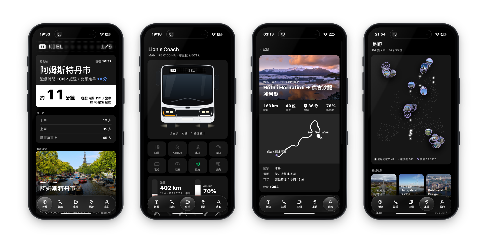

  
  
  

  <a href="README.md">繁體中文</a> · <b>English</b>
   
  <b><a href="https://project-coach-companion.vercel.app/">Download</a></b> ·
  <a href="https://www.youtube.com/watch?v=h_-Mhx5Eh00">Video</a>

Drive in the cab and keep the screen clean; the phone next to you shows the rest. Coach Companion is a free, unofficial companion for Euro Truck Simulator 2 coach jobs. A small program on your gaming PC reads the game, and your phone opens it in the browser over the same Wi-Fi. No account, no phone app to install. The app is in English and Traditional Chinese.

- **Arrive**: when you reach a city, a guide to it and the sights nearby, with photos.
- **Route**: every stop of the trip and the distance to the next one.
- **Fuel**: a warning when the tank will not reach the last stop.
- **Coach**: a front view that follows your lights, indicators and wipers, plus the gauges.
- **Keepsake**: a card for every finished trip, and a map of the places you have been.

 The game and the phone recorded together (4:36)

## Install

**[Download from the website](https://project-coach-companion.vercel.app/)**: Windows 10 or 11, Euro Truck Simulator 2 on Steam. The site has an illustrated guide and the SHA-256 checksum.

1. Close Euro Truck Simulator 2.
2. Extract `CoachCompanion.zip` and double-click `Install.cmd`; approve the administrator prompt (it adds the firewall rule).
3. Scan the QR code on your PC with your phone's camera to pair.

The map of the whole game comes with Coach Companion; there is nothing else to set up.

## Good to know

- **Not navigation**: the map shows where you are and the stops, but gives no directions. Keep using the game's GPS. Route guidance may come later.
- **Stops**: the first time you drive to a stop, its position is estimated (shown as "about"); after one visit it is exact.
- **Privacy**: trips and pairing stay on your PC. The program only contacts Wikipedia for the guides and GitHub once a day to check for updates.

This repo only holds the release packages; notes for each version are under [Releases](https://github.com/Darren901/coach-companion-releases/releases).

---

Euro Truck Simulator 2 is a trademark of SCS Software. Coach Companion is an unofficial fan-made tool, not affiliated with SCS Software.
