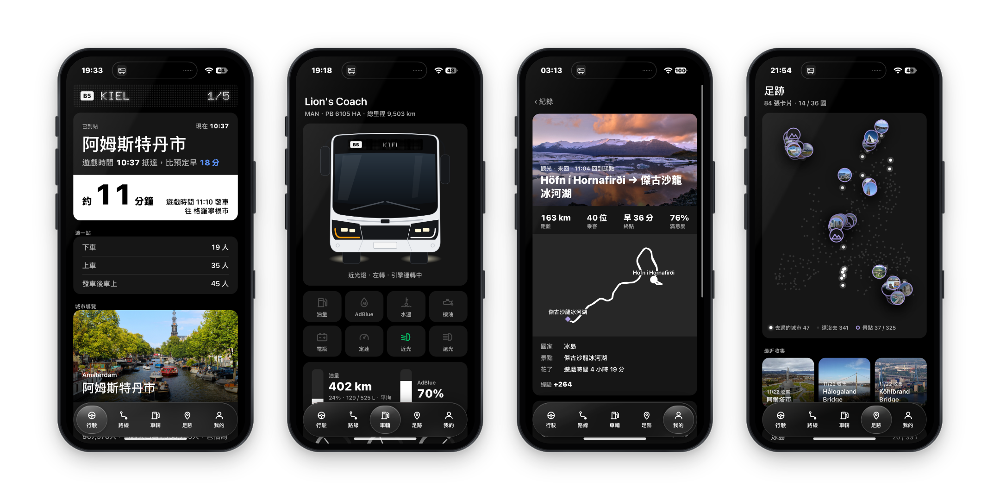

  
  
  

  <b>繁體中文</b> · <a href="README.en.md">English</a>
   
  <b><a href="https://project-coach-companion.vercel.app/">下載</a></b> ·
  <a href="https://www.youtube.com/watch?v=h_-Mhx5Eh00">影片</a>

想沉浸式開客運、畫面不要太多雜訊，其他資訊就交給旁邊的手機。Coach Companion 是免費、非官方的 Euro Truck Simulator 2 客運手機副駕：遊戲電腦上的小程式讀取遊戲，手機用瀏覽器連同一個 Wi-Fi 就能用，不用帳號，也不用裝 App。

- **到站介紹**：開進城市就顯示這座城市和附近景點的介紹與照片。
- **路線**：這趟停哪幾站、離下一站還有幾公里。
- **油量提醒**：油不夠開到終點會先提醒你。
- **車輛**：手機裡的客車跟著遊戲的大燈、方向燈、雨刷同步，還有各種儀表。
- **紀念卡與足跡**：每跑完一趟留一張紀念卡，去過的城市和景點都會記在地圖上。

 遊戲和手機同步錄下的一趟（4:36）

## 安裝

**[到網站下載](https://project-coach-companion.vercel.app/)**：Windows 10 或 11、Steam 版 Euro Truck Simulator 2。網站上有圖文安裝教學和 SHA-256 檢查碼。

1. 關掉 Euro Truck Simulator 2。
2. 解壓縮 `CoachCompanion.zip`，雙擊 `Install.cmd`；跳出系統管理員確認時按「是」（用來加防火牆規則）。
3. 用手機相機掃描電腦上的 QR code 配對。

整張遊戲地圖已經包在 Coach Companion 裡，不用另外設定。

## 使用前須知

- **沒有導航**：地圖顯示你在哪和這趟的站點，找路請繼續用遊戲內建的 GPS，路線規劃之後可能會加。
- **站點位置**：第一次去的站點是估算的（顯示「約」），停過一次就會記住準確位置。
- **隱私**：行程和配對資料都留在你的電腦上，程式只會連 Wikipedia 取得介紹，每天連一次 GitHub 檢查新版本。

這個 repo 只放安裝包，每一版的說明在 [Releases](https://github.com/Darren901/coach-companion-releases/releases)。

---

Euro Truck Simulator 2 是 SCS Software 的商標。Coach Companion 是玩家自製的非官方工具，與 SCS Software 無關。
